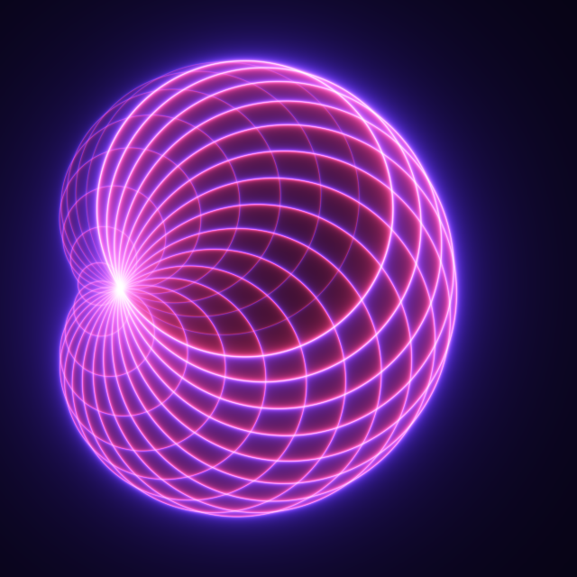

# Pencil

A declarative language for mathematical figures. A figure is a text file that says what's in it and what each thing means, and style sheets say how it looks. The same file renders as an interactive figure on the web and as video.

**It's early, and the syntax will change.** I'm building it to make my own math explainers.



That's this figure, which is all of it:

```
doc limacon
duration 6.2831853

viewport { x: -1.5..10.5, y: -6..6, width: 640, height: 640 }

let a = 8
let x0 = (a + 1 / a) / 2
let x1 = (x0 + 1) / 2
let r1 = (a + 1) / 2 - x1

let focus = (1, 0)

circles rings = circle(c, focus) for i in 0..23 with angle = time - i·tau / 24, c = (r1·cos(angle) + x1, r1·sin(angle))
```

And its style, which is kept apart from it:

```
style paper { fill: black; tone: tanh }
style rings { blend: add; fill_opacity: 0.9^i·tanh(self.pixel / 2 / abs(self.dist)) }
style rings::inside { fill: rgb(1275, 255, 510) }
style rings::outside { fill: rgb(510, 255, 1530) }
```

## What's in it

- **Expressions, not drawing calls.** Points are complex numbers, derivatives are exact, and a `solve` can find unknowns each frame. A figure compiles to an IR with its expressions in MathJSON, so it isn't locked into this tool.
- **Time and input are the same thing.** Animation and interaction both bind the params of one figure.
- **Collections and maps.** One declaration can draw thousands of dots, circles or curves, and can go through a function, so one thing can appear in several panels.
- **Strokes and sides that follow the math.** A circle has a handedness and can pass through a line, and both of its sides can be drawn at once.
- **Two renderers that check each other.** A Rust core compiles figures to WGSL for WebGPU and WebGL2, and a separate CPU interpreter defines what each pixel should be. `pencil check` compares them.

## Trying it

You'll need [Rust](https://rustup.rs). `ffmpeg` is only needed for video.

```bash
# Render a frame
cargo run --release -p pencil-cli -- render corpus/012-limacon/limacon.pen --style corpus/012-limacon/plain.style --t 1 --out out/limacon.png

# Compare the GPU with the CPU
cargo run --release -p pencil-cli -- check corpus/012-limacon/limacon.pen --style corpus/012-limacon/plain.style

# Export a video
cargo run --release -p pencil-cli -- video corpus/012-limacon/limacon.pen --style corpus/012-limacon/plain.style --size 1280 --out out/limacon.mp4

# Run the tests
cargo test --workspace
```

To see the figures live in a browser, which also needs the `wasm32-unknown-unknown` target:

```bash
rustup target add wasm32-unknown-unknown
scripts/build-web.sh
python3 -m http.server 8741
```

Then open <http://localhost:8741/web/limacon.html>. `web/` has the other figures too, and adding `?gl` to a page uses WebGL2.

## Finding your way around

- [`docs/language.md`](docs/language.md): the syntax, built-ins, styles and language decisions.
- [`docs/goals.md`](docs/goals.md): what this is for, and what each figure found.
- `corpus/`: the figures and their expected IR.
- `crates/`: `pencil-core` (parser, IR, styles, CPU oracle, WGSL), `pencil-render` (wgpu), `pencil-cli` (the `pencil` command) and `pencil-web` (the browser host).

## License

[MIT](LICENSE). By Kris Selden, built with [Claude Code](https://claude.com/claude-code).
