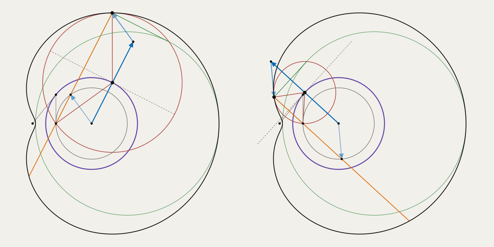
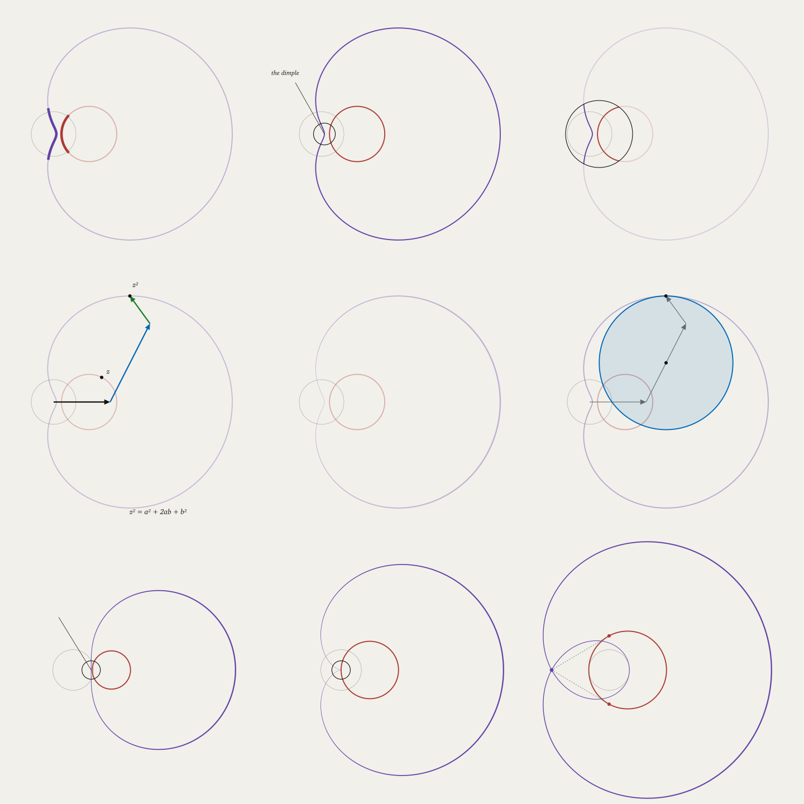

# Plan: a first explainer, the limaçon from its central circle

Written 2026-11-06, and reworked 2026-11-08 around Kris's GeoGebra construction, after a first draft built it up from squaring a circle.
Phases 1 to 4 are built, and the cut is drafted in `lab/explainer`. Narration and the write-up are open, and "Phases" says what each found.

## Why this one

Pencil has made a dozen figures and no explainer. Making one is the quickest way to find out what's missing. `012-limacon` is already the payoff, and its 24 circles have their centers on one circle, the central circle. Only what this video needs gets added to the language.

## The construction



From `lab/highlights/central.pen`, with ordinary marks, `mirror` and `perpendicular`. The GPU matches the oracle within 1/255.

0 and 1 are fixed, and so is s. The **central circle** is about `A = cosh² s`, with radius `sinh s cosh s`. Its tangent from 0 touches it at B, right above 1. A point C goes around it, and everything else comes from C, mostly by reflection:

| Thing | How it's made | What it is |
|---|---|---|
| E | 1 reflected across the central circle's tangent at C | A point of the limaçon |
| The circle about C through 1 | Through 1, and so through E too | One of the 24, touching the limaçon at E |
| Line CE | 1C reflected across AC | The limaçon's normal at E. Its tangent is square to it there. |
| D′ | 1 reflected in A, at `cosh 2s` | The center of the pedal circle |
| The pedal circle | The central circle scaled by 2 about 1, so radius `sinh 2s` | The foot from 1 onto each of its tangents is E |
| A′ | A reflected in C | The slow arm's tip, so C is its midpoint |
| Pascal's circle | About A, from 1 to `cosh 2s`, radius `sinh² s` | The conchoid's base |
| L | A plus the fast arm, `sinh² s` at angle `2t` | Where the line from 1 meets Pascal's circle. E is `sinh 2s` farther along that same line. |
| E′ | E reflected in L | The conchoid's other point, `2 sinh 2s` from E |

**The sum:** from A, the slow arm `2 sinh s cosh s · e^(it)` then the fast arm `sinh² s · e^(2it)` reaches E. The roulette adds them in that order, and the conchoid adds them the other way around, through L. So A, A′, E and L are a parallelogram. The sum is also `(cosh s + sinh s · e^(it))²`, so the roulette is squaring, and the fast arm's doubled angle is the inscribed angle in Pascal's circle: about 1, it's `r = 2 sinh² s · cos θ`.

### Checked

Run on 2026-11-08, by rebuilding the GeoGebra construction step by step, at four values of s and 997 of t. The rebuild also matches the file's own point E, within 1.4e-14.

| Claim | Worst error |
|---|---|
| The tangent at B meets the axis at 0, and B is above 1 | 8.9e-16 |
| D′ is at `cosh 2s` and `|BB′|` is `sinh 2s` | 4.4e-16 |
| The circle about `cosh s` with radius `sinh s` crosses the axis at `e^(∓s)` | 4.4e-16 |
| E is the square of the matching point on that circle | 4.1e-14 |
| E is on `Mirror[DC, AC]`, and the circle about C through 1 also goes through E | 5.3e-15 |
| That circle touches the limaçon at E | 1.8e-15 |
| `K = |z²|`, so O, E and K make an isosceles triangle | 4.3e-14 |
| E′E is `2 sinh 2s` long and parallel to AC, and its midpoint L is on Pascal's circle | 1.5e-14 |
| The pedal: the line through E square to 1E, so parallel to the mirror, touches the circle about `cosh 2s` with radius `sinh 2s` at `2C − 1`, and the foot from 1 onto it is E. (The line square to the normal CE doesn't: it misses by up to 2.7.) | 3.6e-15 |
| The roulette: A′ is the hub plus the slow arm, and `|A′E|` is `sinh² s` | 2.6e-14 |
| Pascal's circle about 1 is `r = 2 sinh² s · cos θ` | 3.6e-15 |
| About 1, `E − 1 = (sinh 2s + 2 sinh² s · cos t) · e^(it)` | 1.1e-14 |
| C is the midpoint of the slow arm | 0 |
| The limaçon inverts to itself in the unit circle, for every s | 9.8e-15 |

## The story

About 75 seconds, in one plane, with no camera moves. The captions are drafts for Kris's voice. The central circle runs through it all, since every other step is a reflection across something attached to it.

| # | Seconds | Caption | On screen | Highlight |
|---|---|---|---|---|
| 1 | 6 | The tangent from 0 touches this circle right above 1. | 0, 1, the central circle, B. | The tangent and the line down to 1. Cut it first if the video runs long. |
| 2 | 12 | A circle about any point of it, through 1. | C goes round once, with its circle through 1. 24 of them stay behind, faint, and the curve they all touch is there to be seen. | The circle that's current. The rest recede. |
| 3 | 12 | Reflect 1 across the tangent at C. That's where its circle touches the curve. | The tangent at C, as a mirror. E opposite 1. The normal CE, and the curve's tangent square to it at E. E traces the limaçon. | A mirror motif: the dashed mirror line, 1 and E with equal ticks to C. |
| 4 | 10 | Double the central circle from 1. The curve is where 1's perpendiculars meet its tangents. | The pedal circle grows out of the central circle. The tangent through E, and the foot from 1. | The scaling about 1, then the right angle at E. |
| 5 | 12 | Pascal's circle. Seen from 1 its angle is t, and from its center it's 2t. Go `sinh 2s` farther. | Pascal's circle. The line from 1 through L, at angle t, and the fast arm from A at 2t. E and E′, either side of L. | Both angles as arcs. The conchoid segment in orange, as in the GeoGebra file. |
| 6 | 14 | Or add the arms the other way around: hub, slow arm, fast arm. That's squaring. | The slow arm to A′, then the fast arm to E. The parallelogram with L. Then the expression `(cosh s + sinh s·e^(it))²`, with each term in its arm's color. | The arms and their terms, sharing colors. The arms run, with E riding on the end. |
| 7 | 9 | (none) | The paper goes black, and the 24 circles from beat 2 light up on both sides, as in `012-limacon`. | Nothing. It's the payoff. |

**Look and motion, from Kris (2026-11-08):**

- **The glow is a Moffat profile, not `tanh(pixel/|d|)`:** `f(d) = (1 + 15·d⁴/a⁴)^(−1/4)`, where `a` is the distance at half brightness, as `moffat_glow` in the site's `doyle-spiral-shader` does. It's 1 on the line, with no division by 0. Its integral is `F(d) = (atan(k·d·f(d)) + atanh(k·d·f(d))) / 2k` with `k = 15^(1/4)/a`, checked against direct integration to 6.5e-10, so `(F(d + h) − F(d − h)) / 2h` is the glow averaged exactly over a pixel. Its tail falls as `1/(k·d)`, so the light of many still piles up, and `tanh` stays as the tone map.

- **Dark paper throughout,** with colors chosen to carry into the glow, so beat 7 is the same figure lighting up and not a change of scene. The GeoGebra file's colors were only its default palette.
- **A reflection turns in 3D about its mirror line.** The in-between frames are a half turn at even angles, seen from in front, not a straight slide across the line in 2D. A point `p` across a line with foot `f` is at `f + (p − f)·cos θ` for θ from 0 to π, so it slows as it reaches the line edge-on and speeds up through it. A curve does the same point by point, so a circle turning over becomes a thinning ellipse.

This leaves out much of the GeoGebra file on purpose: K and its isosceles triangle, the circle about `cosh s` and where it crosses the axis at `e^(∓s)`, and inversion.

**Inversion isn't covered.** The first draft's "near edge" beat left the family of circles whose limaçons invert to themselves in the unit circle at 0, so in that draft it would only have been true at one moment. That beat is gone. In this story it's true at every moment, since the power of 0 stays 1 for every s, but nothing shows it. It could be a video of its own, about how the limaçon looks from 0, with the median from the site's post.

## Highlights and callouts



From `lab/highlights/render.sh`, on the first draft's geometry, though the techniques carry over. Top row: a part, a ring with a note, a spotlight. Middle: arms and terms, a stroke following the scale factor, a construction as its own highlight. Bottom: the first draft's flat, cusp and loop.

**Everything here draws today.** Each one is an ordinary mark and an ordinary style rule. What's missing is a good way to say when.

| Way | What it tells the viewer | Today |
|---|---|---|
| **Recede** | Look at these. Everything else steps back, and nothing moves to get attention. | Works, with one `let` per state that a sheet has to know by name. |
| **A mirror** | These two are reflections. | The mirror line and the link are segments, and `mirror` gives the point. There are no tick marks for equal lengths. This is the motif for the new story. |
| **A part, in both planes** | This piece becomes that piece. | Works. A range in a `group`, used `through` the map, can't disagree with itself. |
| **Ring and note** | This spot has a name. | The ring is a dot with a stroke. The leader is a segment worked out by hand, and it runs through the ring to the center. |
| **Spotlight** | Only this area, for now. | Works: `::outside` filled with the paper's color. Labels draw on top, so they wouldn't dim, which is untried. |
| **Symbol and geometry share a color** | This term is that arrow. | Works, as in `006-square`, but with gaps below. |
| **A stroke follows the math** | The curve moves fastest here, and stops there. | Works: `width` from `2|z|` at `self.t`. The sheet has to write out that formula, since `i` isn't available in a style. |
| **The construction is the highlight** | No marker needed, since the circle itself says it. | Works. |

Three ideas go with those:

- **Decoration should be geometry.** The best ones above aren't drawn on top of the figure. They're more of it. A mirror line that is the tangent at C beats an arrow saying "reflect".
- **Attention comes from what recedes.** No pulsing, blinking or bouncing, because motion that doesn't explain anything spends the budget. A highlight arrives by `snap`, holds, and ends with its beat.
- **A highlight is a binding.** It has to work when a reader steps or drags as well as in a video, so it can't depend on the clock directly.

**Not available, and not needed yet:** color along a curve. `self.t` only works in `width`.

## Appearing and disappearing

Manim treats appearing as an animation that plays: `Create`, `Write`, `FadeIn`, `GrowFromCenter`, and `Uncreate` or `FadeOut` to remove. Pencil can't do it that way, since a frame depends only on its inputs, and a reader stepping back has to see a thing disappear without anything having been played. The split that fits:

- **When a thing exists is the document's.** What's in the figure at a moment is part of what it says. A beat's marks appear with it, as `beat "…" { … }` already does, and a beat can `drop` marks it's done with.
- **How it arrives and leaves is the sheet's:** fading, drawing along, growing from a point.
- **Unless the order means something.** E tracing the limaçon as C goes round is the math, so it's a range driven by the beat's progress, in the document. Being drawn on is just an arrival, so it's in the sheet. Ask whether a different order would be wrong. If so, it's the document's.

The mechanism is two primitives, and presets can come later if they earn it:

- `self.life` is 0 before a mark exists, rises to 1 as it arrives, holds there, and falls to 0 as it leaves. It's worked out from `beat`, so stepping, seeking and video all agree.
- `trim` draws a stroke from its start to that fraction of its parameter, so `trim: self.life` draws a curve on, and an arrow grows from its tail.

```
style .figure { opacity: self.life }               // fade, the default
style circle, curve { trim: self.life }            // drawn on
style dot { radius: 3px·self.life }                // grow from a point
```

Drawing along the parameter, not the length, puts some of the math into the arrival: a circle about C through 1 is drawn starting from 1, the way a compass would draw it.

Manim's `Transform` doesn't need an equivalent. A shape changing into another is a param moving, as `009-squaring` does with `z^p`, and an expression's terms already move by identity.

## Timing from narration

Kris: a recorded voice, with stressed syllables on the words that match the picture, should be able to retime what's composed.

- **Beats have lengths, not times**, so moving one moves everything after it (below). That's what makes retiming possible at all.
- **A beat can name the word it lands on:** `beat pedal "…" for 10 on "perpendiculars"`. That word is in its caption, so the caption is also the script.
- **The recording gives each word a time.** A forced aligner produces word times from audio and a script, and Kris or a tool marks the stressed syllable if the word alone isn't precise enough. `pencil video --narration voice.wav --cues cues.json` reads both.
- **Retiming is a map from story time to clock time:** piecewise linear, passing through each anchored moment. **Holds stretch, and moves keep their length,** so a fade or a `snap` doesn't slow down just because the speaker did.
- **The document doesn't change.** Narration is one more thing that drives `beat`, as time and a reader do. A page without the recording uses the written lengths.

Not decided: whether "lands on" means the beat starts on the word or its arrival finishes on it. Finishing seems right, since the picture should complete as the word is stressed.

## What's missing

Tried on 2026-11-06 and 2026-11-08.

**Needed for this video:**

1. **Timing.** `006-square` keeps absolute times in a `timeline`, then more in `smoothstep(7.8, 8.4, time)`, in two places. Lengthen a beat and everything after it has to be retimed by hand.
2. **Focus.** The sheet has to know the document's private names, such as `parts` and `fade`.
3. **Appearing and disappearing:** `self.life`, `trim` and `drop`.
4. **Captions in video.** A `beat`'s caption reaches the page through `info()` and never reaches `pencil video`.
5. **Changing `tone`.** It's `clip` or `tanh` for a whole figure, and beat 7 needs it to change. Paper color can already change over time.
6. **Tick marks for equal lengths,** for the mirror motif. A segment could carry them as a style, `ticks: 1`.
7. **A leader on a label.**

**Traps to fix, since each one fails quietly or confusingly:**

8. **A repeated term disappears.** `"a + b + c"` draws `a   b + c`, because the second `+` is the same term as the first. It should be an error that suggests `+.1`, or operators shouldn't count.
9. **A term can't be selected if its name starts with a digit,** so `style term.2ab` is a parse error. `a²` hasn't been tried.
10. **`time` in a fixed viewport is ignored.** `x: -2 - time..2 + time` is evaluated at 0 and stays there, while a `let` in the same place is an error. `fit` does follow time.

## The design

### Beats take a length and say what they're about

```
beat circles "A circle about any point of it, through 1."   for 12 focus through_one, central
beat mirror  "Reflect 1 across the tangent at C."           for 12 focus tangent_at_C, E, normal
beat hold                                                   for 2

bind t = tau·circles
```

- **Lengths, not times,** so changing one moves everything after it. They add up to the `duration`.
- **A beat's name is its progress,** 0 to 1 and then staying at 1, so `circles` above is what drives `t`. There are no more times to keep in step, and `snap(circles)` is there if it should ease.
- **`beat` stays one number,** as `step` is today: at 3.4 it's on its way through beat 3. Time drives it in a video, a page's Back and Next can drive it, and so can narration, so this is still a binding.
- **`focus` names marks or tags,** and `self.focus` is 1 on those during that beat, easing between beats. So the document says what each beat is about, and one sheet rule says how that looks:

```
style .figure { opacity: mix(0.3, 1, self.focus)·self.life }
```

This is the site's construction rule, with the newest at full strength and earlier ones faded.

### A term can have a name, and share it with a mark

`"slow:2ab"` prints `2ab` and is tagged `slow`. An arrow tagged `slow` then shares everything with it:

```
arrow slow_arm = A, A2 tag slow
style .slow { stroke: blue; fill: blue }
beat roulette "Or add the arms the other way around." for 14 focus .slow, .fast
```

So one name ties the color and focus of a symbol to its geometry, in one place. That fixes trap 9 too.

### A callout is a label with a leader

```
label dent = "the dent" at P away D tag callout
style label.callout { distance: 46px; leader: 1px; leader_gap: 24px }
```

No new kind of mark. It rides along with `P`, its side goes through maps exactly as `away` does now, and how far away it sits and whether it has a line are the sheet's. `leader_gap` is how the line stops at a ring. For now it would only work with `place: fixed`, since a settling label's position differs between a page and a video.

## Phases

Each ends with everything passing, and the GPU matching the oracle.

1. **Traps 8 and 10.** Small, and they stand alone. Trap 9 goes with named terms. **Done 2026-11-08:** both are errors now, with what to write instead. The same check covers `duration`, a param's range and a panel's layout, which read `time` the same way. Two things it found: this plan's own sketch had written `+` twice, and a number can't have a copy, since `2.1` is a number, so a repeated number can only be an error for now.
2. **Beats with lengths, progress and focus, `self.life`, `trim` and `drop`, and captions in video.** Proof: `006-square` rewritten with no absolute times, compared with the original frame by frame, and with its sheet no longer naming `parts` or `fade`. **Done 2026-11-08, except `trim`:** `pause`, beats with `for`, `show`, `drop` and `focus`, a beat's name as its progress, `self.life`, `self.focus`, and `style caption`. Everything is worked out from `beat`, so nothing moves during a pause. `006-square` matches the original exactly at 13 of its 16 holds, and the three others differ only because the original drew a copy of `z` on top of `z` a state early, which made it a little darker. That's a bug of its own in how copies are drawn. During moves, the differences are only easing. `trim` came after, the same day: a stroke is cut where it becomes segments, which the GPU and the oracle share, and a trimmed circle is drawn as a line. A circle starts due east of its center for now, since circles only keep their center and radius. Beat 2's circles through 1 can be written as parametric curves starting at 1 until circles remember a start.
3. **Named terms, ticks and leaders,** and `tone` as a value that can change. Proof: still frames of beats 3, 6 and 7. **Done 2026-11-08:** `slow:2ab`, `ticks`, `leader` and `leader_gap`, and `tone` from 0 to 1. The proof is `lab/explainer/proof.pen` and `web/proof.html`, three beats on dark paper that light up into the glow, and the GPU matches the oracle within 1/255 throughout, with the tone halfway. Leaders were planned for fixed labels only, but they're drawn by each renderer once a label has settled, so they work for settling labels too. What it found:
   - **A selector's name matches tags too,** so `style slow` reached the term tagged `slow` as well as the arrow, and `trim` on a term is an error. `style arrow.arm` says which.
   - **The paper is clipped before the tone,** so a paper brighter than white doesn't glow.
   - **The glow needs a narrow profile.** At 3 device pixels to half brightness, the 1/d tail of 24 circles washed the picture out. At 0.75 it's about as bright as `012-limacon`'s `tanh`.
4. **The video, one beat at a time,** with Kris watching each before the next. Timing can only be judged in motion, so this is where most of the work will be. **Drafted 2026-11-08:** all seven beats, in `lab/explainer/limacon.pen`, 65 seconds, and the GPU matches the oracle within 1/255 at every moment checked. Kris's one note on the first cut was to make it punchier, so arrivals `snap` and beats are shorter than the table above. What it found:
   - **A parametric range that ran down drew nothing,** without a word, so `for u in 0..t` vanished for a negative angle. It's drawn from its first bound now, and `trim` and a head follow that direction.
   - **This plan's pedal claim was misworded.** The line through E that touches the pedal circle is square to 1E, so parallel to the mirror, not square to the normal CE. It touches at `2C − 1`. The table above is corrected.
   - **The math font has `ᵗ` but not `ⁱ`,** and the renderer has no fallback, so `e^(it)` became u, a unit number at angle t. That reads better anyway, since u² at 2t is beat 5's doubling.
   - **Terms that aren't operators set tight,** so `cosh s` printed as `coshs`, and a label is always centered on its point. The definitions under the sum are short expressions of their own, written `cosh(s)`.
   - **A dropped mark leaves only as its sheet says,** so each rule needs `self.life` in it to fade. What no beat ever shows has no life to read, and the sheet fades it by the `quiet` beat's progress instead.
   - **The 24 circles are weighted alike in the glow,** unlike `012-limacon`'s `0.9^i`, since here they're an evenly spaced family and not a trail behind a moving point.
5. **Narration,** once there's a cut worth recording over. **Started 2026-11-10:** `lab/narration` drafts a script with a synthesized voice, aligns any take to it, and retimes the beats so each lands on its word's stressed syllable. The whole script is drafted, and C has a label that appears as it's said. `goals.md` has what it found.
6. **Write up what it found** in `goals.md` and the language reference.

## Decisions for Kris

Recommendations first.

1. **The story.** Is this the right order: circles, then the mirror, the pedal, the conchoid, and the roulette last as squaring? And does beat 1, where 0 comes from, stay?
2. **Sound.** Captions in the figure now, and Kris's voice recorded over it later. Pencil itself stays silent, and narration only drives timing.
3. **What "lands on a word" means:** the arrival finishing on the stressed syllable.
4. **`self.life` and `trim` as primitives,** with no `enter: fade` presets until they're needed.
5. **Shape.** 16:9. The limaçon is a little taller than it is wide, so the sides are free for the expression and the captions.

## Not checked

- **None of this has been seen in motion.** The images are still frames, and motion is where a story like this can fail.
- Everything was rendered natively, not in a browser. The construction and the cusp in the first draft's figure each matched the oracle within 1/255, at one moment, and the other sketches weren't compared.
- The text isn't settled either: `pencil video` uses system fonts, which can't be redistributed. That doesn't block a video, but someone else's render would look different.
